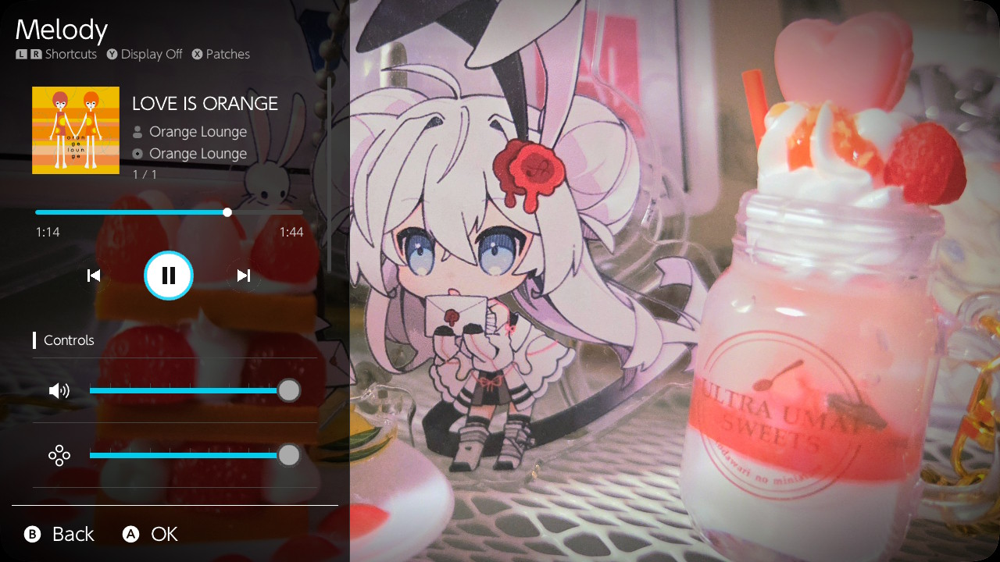

```
----------------
   sys-melody
----------------

An overlay for the Nintendo Switch that plays back FLAC and OPUS files.
Additionally includes other helpful features such as:

- Music Playlists and Queues
- Shuffle and Repeat modes
- Game and Music volume bars
- Album Covers (via Metadata or 'cover.jpg' in album folder)
- Equalizer Support (via Equalizer APO config format)
- Lock Feature: turn off display and ignore button presses (hold Y to toggle)
- Patches for High Quality and Low Latency Bluetooth Audio 
  (press X to access menu) (experimental)

[ Made with AI ]

----------------
  Installation
----------------

(1) Install Ultrahand
(2) Extract 'atmosphere' and 'switch' folders to the root of your SD Card
(3) Create a folder named 'Music' at the root of your SD Card
(4) Copy your '.flac' and '.opus' files into your 'Music' directory

----------------
    Caveats
----------------

<!> Melody only supports FLAC or OPUS format audio to keep it purposely light
    on memory along with the fact that I believe that these two codecs are the
    correct audio formats to use as pretentious as it sounds :P

<!> A patch is included to prevent the HOME overlay from temporarily ducking 
    the game audio when it is opened as this behavior breaks the game volume
    bar. This patch is optional and can be removed by deleting the 
    'melody_audio_disable_attenuation' folder located at 
    'sdmc:/atmosphere/exefs_patches/' after installing Melody.

<!> The included patches are for firmware 23.5.0 only. On other firmware
    they do nothing, and the Patches menu will be disabled.

----------------
   Screenshots
----------------
```
<table>
  <tr>
    <td width="100%"></td>
  </tr>
</table>
